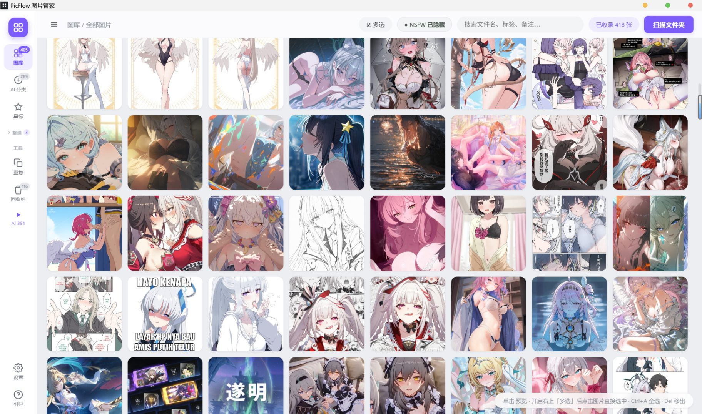
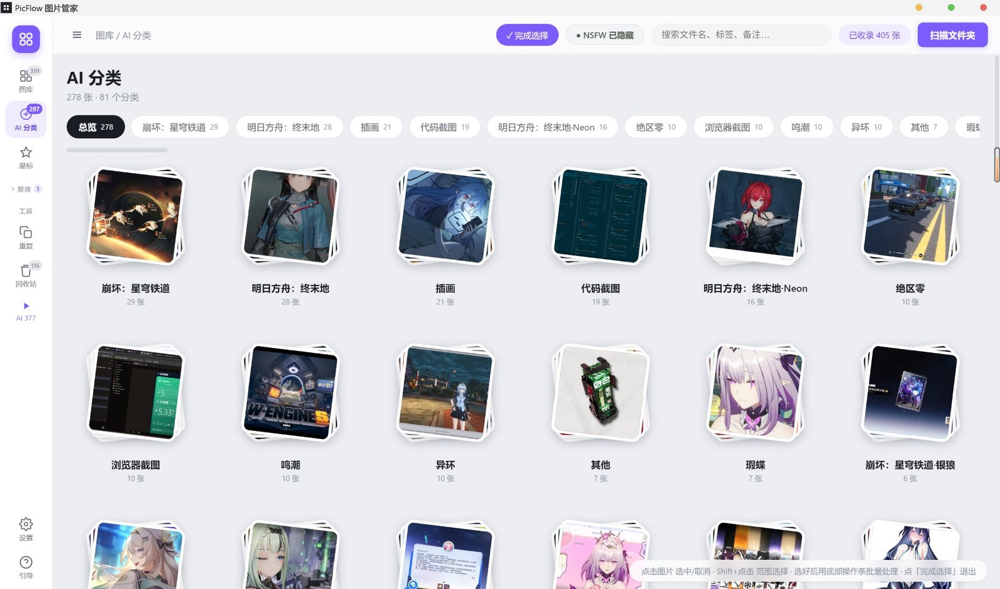

<p align="center">
  
</p>

<h1 align="center">PicFlow</h1>

<p align="center">A Windows and macOS desktop photo library · local-first · cloud AI tagging · privacy-first</p>

<p align="center">
  <a href="https://github.com/Slimeissoft/PicFlow/releases/latest"></a>
  
  
  
  <br>
  
  
  
</p>

<p align="center">
  <a href="README.md">简体中文</a> · <b>English</b> · <a href="README.zh-TW.md">繁體中文</a> · <a href="README.ja.md">日本語</a>
</p>

<p align="center">
  
</p>
<p align="center"><sub>Library view — browse by date, AI category, album or tag on the left; tri-state NSFW filter and search on top; click any thumbnail to preview</sub></p>

## Features

- **Library management** — scan folders (including subfolders), thumbnail grid, filter by date / type / tag, full-text search
- **AI tagging** — call your own multimodal API; it recognises game titles, character names and image types, then groups images into categories such as "Honkai: Star Rail", "Arknights" or "Code screenshot"
- **Manual tagging** — label an image from the lightbox category pills or by pressing `C`; select several images to batch-label. The picker shows per-category counts, supports search and lets you create a category on the spot. Manual labels are never overwritten by AI runs
- **Context menu** — right-click any image for a menu with a thumbnail header: preview, open with default app, reveal in Explorer, copy image / path, star, mark NSFW, tag category, add to album, rename, move, remove from library, delete permanently. Works on multi-selections. Text inputs keep the native undo / paste menu
- **Privacy** — every image is checked locally with nsfwjs first; anything flagged NSFW is **never uploaded**, it only gets a local mark
- **Albums / tags / stars / notes** — an image belongs to one album at a time; adding it to a new album removes it from the old one
- **Duplicate detection** — perceptual hash (pHash) to find duplicates and similar shots
- **Batch operations** — multi-select, batch tagging, batch rename, move, remove, permanent delete (to the system Recycle Bin)
- **Viewer & zoom** — scroll to zoom, double-click for fullscreen; in fullscreen, click the image to zoom 2.6× at that point, drag to pan. The ratio badge shows magnification and the percentage of native pixels — click it or press `1` for 1:1. The lightbox loads the original file, not the thumbnail. `←` / `→` to navigate, `Esc` restores zoom before closing
- **Rename / merge categories** — rename an AI category or merge it into another one; the whole group updates and stays put after re-tagging
- **Collapsible albums** — the "整理" (organise) header in the sidebar folds the album list away
- **Four UI languages** — 简体中文 / 繁體中文 / English / 日本語, switchable instantly in Settings
- **Folder sync** — rescans on launch and silently every 5 minutes, so external changes show up automatically
- **Auto update** — new GitHub Releases trigger an in-app prompt with one-click download and install

## AI categories

<p align="center">
  
</p>
<p align="center"><sub>Category overview — each category gets an auto-picked cover, its name and count; click to open the group</sub></p>

Results are not one vague "anime" bucket. You get entries you actually recognise — "Honkai: Star Rail", "Arknights: Endfield", "Code screenshot", "Browser screenshot", "Zenless Zone Zero".
The overview is sorted by image count. Categories can be renamed or merged, and manually tagged images are never overwritten.

## Install

Latest release: **1.6.3**. Both platforms download from [Releases](https://github.com/Slimeissoft/PicFlow/releases/latest).

**Windows (10 / 11 x64)**

1. Download `PicFlow-Setup-1.6.3.exe`
2. Run the installer (you can pick the install directory)
3. On first launch, click **Scan folder** to import your images

**macOS (11 Big Sur or later, Apple Silicon / Intel)**

1. Download `PicFlow-1.6.3-arm64.dmg` (M-series) or `PicFlow-1.6.3-x64.dmg` (Intel)
2. Open the dmg and drag "PicFlow 图片管家" into Applications
3. **First launch: right-click the app → Open.** This build has no Apple Developer certificate
   (ad-hoc signed only), so Gatekeeper blocks it once
4. If macOS says the app "is damaged and can't be opened", run:

   ```bash
   xattr -cr "/Applications/PicFlow 图片管家.app"
   ```

The macOS build has no in-app auto-update yet — grab new versions from Releases.

## Configure AI tagging (required)

AI tagging uses your own multimodal API. Image recognition costs a little money, billed to your account.

1. Open **Settings** (gear icon, bottom of the sidebar) → **AI tagging**
2. Pick a provider — the API endpoint and a recommended model are filled in for you:

   | Provider | Recommended model | Notes |
   |---|---|---|
   | OpenAI | `gpt-4o-mini` / `gpt-4o` | Needs a vision-capable model |
   | Anthropic Claude | `claude-sonnet-4-5` | Whole Claude line supports images |
   | Qwen (Alibaba Cloud) | `qwen-vl-max` | DashScope compatible mode |
   | Kimi (Moonshot) | `moonshot-v1-8k-vision-preview` | Vision model required |
   | Doubao (Volcengine Ark) | your Ark endpoint ID | Fill in from the console |
   | SiliconFlow | `Qwen/Qwen2.5-VL-72B-Instruct` | Aggregator, many models |
   | DeepSeek | `deepseek-chat` | Use a vision-capable model |
   | Custom | anything | Any OpenAI-compatible endpoint |

3. Enter your **API key** — encrypted with the OS credential store and kept on this machine only
4. Click **Test connection**, then save
5. Back in the library, click **⚡ AI tag** at the top

**Concurrency**: 3 by default (three images at a time). Lower it on HTTP 429; raise it to 4–5 if you have headroom.

**Cost**: one image input per photo (JPEG downscaled to 1024 px). At typical vision-model prices that is a fraction of a cent to a few cents per image.

## Usage

On macOS read `Ctrl` as `⌘` and `Del` as `⌫` (the UI already renders them that way).

| Action | How |
|---|---|
| Preview | Click an image |
| Zoom | Windowed: scroll wheel (click the ratio badge or press `1` for 1:1) |
| Zoom into detail | Fullscreen: click the image to zoom 2.6× at that point, click again to restore; drag to pan |
| Fullscreen | Double-click; or `F` / the button in the top-right; `Esc` restores zoom first, then exits |
| Previous / next | `←` / `→`, or the arrow buttons |
| Multi-select | Enable **☑ Select** (top right) then click; `Ctrl+A` selects all |
| Context menu | Right-click an image: preview / copy image / copy path / star / mark NSFW / tag category / add to album / rename / move / remove / delete; applies to the whole selection |
| Copy image / path | Context menu, or `Ctrl+C` / `Ctrl+Shift+C` (also works in the lightbox) |
| Quick rename | Select and press `F2` |
| Batch tagging | Select several → **Tag category…** at the bottom → pick or type a category |
| Single tagging | Category pills in the lightbox, **✎ Tag**, or `C` |
| Rename a category | ✎ on the category card, or **Rename category** inside a group; merging is supported |
| Collapse albums | Click the **整理** header in the sidebar; the state is remembered |
| Change language | Settings → General → Interface language |
| Remove from library (keep file) | Select → **Remove**; restore from **Trash** in the sidebar |
| Delete permanently | Select → **Delete** (sends the file to the system Recycle Bin) |
| Duplicates | **Duplicates** view in the sidebar |
| NSFW filter | Top button cycles: hidden → show all → NSFW only |

## Privacy

- Your images never leave your machine; PicFlow has no server of its own
- AI tagging sends the image to **the API you configured** — that is inherent to recognition
- **NSFW images are never uploaded**: each image is checked locally with nsfwjs first and skipped when flagged
- The API key is encrypted with the OS credential store (Windows DPAPI / Electron `safeStorage`) inside `library.json`; the renderer only ever sees "configured or not" plus a mask. Please still keep that file private
- Found a security issue? Report it privately as described in [SECURITY.md](SECURITY.md) — please do not open a public issue

## Auto update (Windows only)

The app checks GitHub Releases in the background (a silent check 8 seconds after launch).
When a new version appears, a bar shows up at the bottom:

- **Download update** → progress → **Restart and install**
- Only the changed blocks are downloaded (electron-updater differential update), which is faster than a full installer

> Versions before v1.4.0 have no auto-updater — install v1.4.0 manually once, and later versions update themselves.
>
> The macOS build is ad-hoc signed (no Developer ID), which Squirrel.Mac cannot verify, so in-app updates are disabled there.

## Data locations

| Item | Location |
|---|---|
| Library data (categories / albums / tags / notes) | `%APPDATA%\PicFlow 图片管家\library.json` |
| Thumbnail cache | `%APPDATA%\PicFlow 图片管家\thumbs\` |
| AI config (API key encrypted) | `flags.cloudAI` inside the same `library.json` |
| Your images | Stay where they are; PicFlow never moves or renames them |

Backup only needs `library.json` (thumbnails can be regenerated).

## Development

```bash
npm install
npm start      # run in development
npm run dist   # build the Windows installer (outputs to release/)
```

Stack: Electron 33 + vanilla JS (no framework) + nsfwjs (local NSFW) + electron-updater.

Key files:

| File | Responsibility |
|---|---|
| `main.js` | Main process: scanning, thumbnails, file ops, AI scheduling, auto update |
| `cloudai.js` | Cloud model calls (OpenAI-compatible + Anthropic protocols, provider presets) |
| `ai.js` | Local NSFW detection (nsfwjs) |
| `db.js` | JSON database (library.json, soft delete, ignore list) |
| `scanner.js` | Directory walk, EXIF dates, perceptual hash (pHash) |
| `renderer/` | UI (index.html / app.js / style.css / i18n.js) |

## Known limitations

- Windows ships an NSIS installer; macOS ships dmg / zip
- The macOS build is unnotarized (ad-hoc signed): right-click → Open on first launch, and no in-app updates
- Tagging speed depends on your provider (usually 1–5 s per image)
- Offline local recognition was removed; AI tagging needs a network connection (everything else works offline)

## Changelog

**v1.6.3** (2026-11-06)

- **macOS support**: Apple Silicon (`arm64`) and Intel (`x64`), each as dmg and zip
- macOS adaptations: `⌘` shortcut hints, `⌫` to remove, standard app menu (`⌘Q` / `⌘W`),
  closing the window keeps the app alive, deletes go to the Trash
- The macOS build is ad-hoc signed (no Apple Developer certificate): right-click → Open on first
  launch, and in-app auto-update is disabled
- Docs: rewrote [SECURITY.md](SECURITY.md); added 繁體中文 and 日本語 READMEs
- No behaviour changes on Windows

**v1.6.2** (2026-11-06) · recommended for everyone

Security hardening, no feature changes:

- **No navigation away from the app**: `will-navigate` only allows `file://`, `window.open` is denied. Previously, once the window was navigated to a remote page, preload was re-injected and that page got the full `window.api`
- **IPC locked down**: 40+ handlers now verify the sender is a local page; `read-image` / `copy-image` / `open-path` / `rename` / `move` / `purge` / `revive` / `open-in-folder` only accept paths recorded in the database or under a scanned folder
- **Path traversal fixed**: rename sanitises `\ / : * ? " < > |` and control characters, and forces the target into the source directory
- **API key encrypted**: stored via `safeStorage`; the renderer receives only `hasKey` and a mask (`sk-…9999`)
- **Renderer sandbox** (`sandbox: true`), preload unchanged
- **Tighter CSP**: explicit `picflow-thumb:` in `img-src`, added `object-src` / `base-uri` / `form-action` / `frame-src`; custom protocol no longer uses `bypassCSP`

**v1.6.1** (2026-11-06)

- **Image context menu** in the grid and the lightbox, with a thumbnail header
  - Preview / open with default app / reveal in Explorer
  - Copy image, copy path (`Ctrl+C` / `Ctrl+Shift+C`)
  - Star, mark NSFW (toggles to "unmark"), tag category, add to album (submenu with current album checked, create new inline), remove from current album
  - Rename (`F2`), move to folder, move to Trash, delete permanently
- Works on multi-selections, header shows "N selected" and total size
- Follows theme and language, flips near screen edges, keyboard `↑↓` / `Enter` / `Esc`
- Trash and category cards get their own menus
- Fixed NSFW button occasionally not turning red after marking (stale object reference after background sync)
- Fixed paste in the search box (native edit menu restored)

**v1.6.0** (2026-11-02)

- **Manual tagging**: category pills in the lightbox, **✎ Tag**, or `C`; batch tagging from the bottom bar
- Picker shows real counts, supports search, creates categories on the fly; manual labels survive re-tagging
- NSFW button turns red / white when marked; star turns amber
- Fixed button states never applying (missing `class=` in the template)
- Fixed the lightbox jumping to another image after marking

**v1.5.0** (2026-10-25)

- Lightbox zoom and pan, 2.6× click-to-zoom, ratio badge, native 1:1
- Rename or merge AI categories; collapsible album list
- "AI settings" became a full Settings panel (General / AI / Appearance / Data / About)
- Four UI languages; horizontal scrolling category bar

**v1.4.0** (2026-10-21) · breaking change

- Removed the local AI model (WD14 / MobileNetV2) in favour of your own cloud multimodal API — better results, smaller installer, local NSFW detection stays so sensitive images are never uploaded
- Batch tagging, fullscreen lightbox, electron-updater

## License

MIT License. Please do not use this software for illegal purposes.

Feel free to enjoy open-source!

Copyright (c) 2026 Slimeissoft

## Contact with Me

- **Email**: [lalouuie@gmail.com](mailto:lalouuie@gmail.com)
- **GitHub**: [@Slimeissoft](https://github.com/Slimeissoft)
