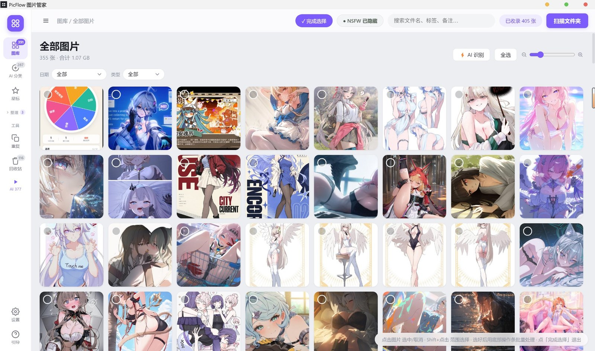
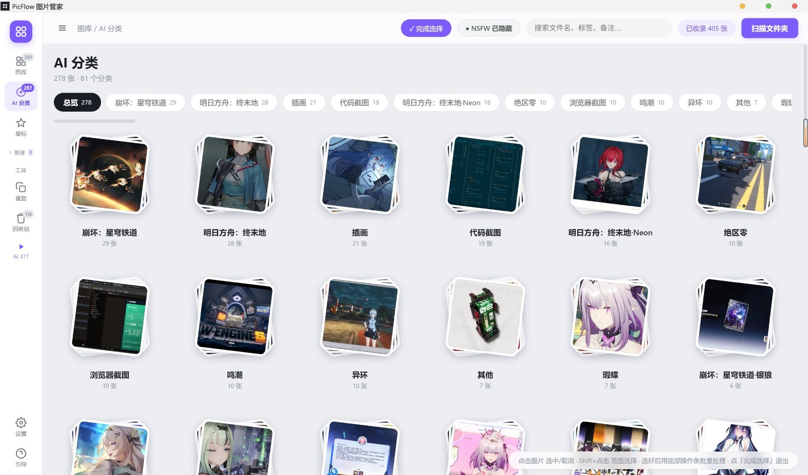

<p align="center">
  
</p>

<h1 align="center">PicFlow 画像マネージャー</h1>

<p align="center">Windows 用デスクトップ画像管理ツール · ローカル管理 · クラウド AI 認識 · プライバシー優先</p>

<p align="center">
  <a href="https://github.com/Slimeissoft/PicFlow/releases/latest"></a>
  
  
  
  
  
  
</p>

<p align="center">
  <a href="README.md">简体中文</a> · <a href="README.en.md">English</a> · <a href="README.zh-TW.md">繁體中文</a> · <b>日本語</b>
</p>

<p align="center">
  
</p>
<p align="center"><sub>ライブラリ画面 — 左側で日付 / AI 分類 / アルバム / タグから絞り込み、上部に 3 段階の NSFW フィルターと検索。サムネイルをクリックで拡大表示</sub></p>

## 機能

- **ライブラリ管理** — フォルダー走査（サブフォルダー含む）、サムネイル一覧、日付 / 種類 / タグでの絞り込み、検索
- **AI 分類** — 自分のマルチモーダル API を呼び出し、ゲーム名 / キャラクター名 / 画像の種類を認識して「崩壊：スターレイル」「アークナイツ」「コードのスクリーンショット」などの分類に自動でまとめます
- **手動タグ付け** — ビューアーの分類チップか `C` キーで 1 枚ずつ、複数選択すればまとめてタグ付け。候補リストには分類ごとの件数が出て、検索もその場での新規作成も可能。手動で付けたタグは AI の再認識で上書きされません
- **右クリックメニュー** — 画像を右クリックするとサムネイル付きのメニューが開きます：プレビュー、既定のアプリで開く、エクスプローラーで表示、画像 / パスのコピー、スター、NSFW マーク、分類タグ、アルバムに追加、名前の変更、移動、ライブラリから除外、完全削除。複数選択ならまとめて実行。検索欄などの入力欄では OS 標準の元に戻す / 貼り付けメニューが出ます
- **プライバシー** — すべての画像はまずローカルの nsfwjs で判定し、NSFW と判定された画像は**一切アップロードしません**
- **アルバム / タグ / スター / メモ** — 1 枚の画像は 1 つのアルバムに所属。新しいアルバムに追加すると前のアルバムから外れます
- **重複・類似画像の検出** — 知覚ハッシュ（pHash）で重複を検出し、まとめて整理
- **一括操作** — 複数選択、一括タグ付け、一括リネーム、移動、除外、完全削除（ゴミ箱へ）
- **ビューアーとズーム** — ホイールでズーム、ダブルクリックで全画面。全画面ではクリックした位置を 2.6 倍に拡大し、ドラッグで移動。右下の倍率バッジをクリックするか `1` キーで原寸 1:1。ビューアーはサムネイルではなく元ファイルを読み込みます。`←` / `→` で移動、`Esc` はズームを戻してから閉じます
- **分類のリネーム / 統合** — AI の分類は名前を変更でき、既存の分類に統合も可能。再認識しても結果は保持されます
- **アルバムの折りたたみ** — サイドバーの「整理」見出しでアルバム一覧を折りたためます
- **4 言語対応** — 简体中文 / 繁體中文 / English / 日本語。設定で即時切り替え
- **フォルダーの自動同期** — 起動時と 5 分ごとに静かに再走査し、外部での追加・削除を反映
- **自動アップデート** — GitHub Release に新バージョンが公開されると、アプリ内で通知しワンクリックで更新

## AI 分類

<p align="center">
  
</p>
<p align="center"><sub>分類の一覧 — 分類ごとに自動で選ばれた表紙、分類名、枚数を表示。クリックでその分類を開きます</sub></p>

結果は「アニメ」のような大雑把なタグではなく、「崩壊：スターレイル」「アークナイツ：エンドフィールド」「コードのスクリーンショット」「ブラウザのスクリーンショット」「ゼンレスゾーンゼロ」のように、見て分かる単位で分類されます。
一覧は枚数の多い順に並び、分類はリネームも統合もでき、手動でタグ付けした画像は AI に上書きされません。

## インストール

1. [Releases](https://github.com/Slimeissoft/PicFlow/releases/latest) から `PicFlow-Setup-*.exe` をダウンロード
2. インストーラーを実行（インストール先は選択可）
3. 初回起動時に「フォルダーを走査」で画像を取り込み

必要条件：Windows 10/11 x64。最新版は **1.6.2**（セキュリティ強化、アップデート推奨）。

## AI 認識の設定（必須）

AI 認識には自分のマルチモーダル API が必要です（画像認識には少額の費用がかかり、ご自身のアカウントに請求されます）。

1. サイドバー下部の **設定**（歯車アイコン）→ **AI 認識** を開く
2. プロバイダーを選ぶと、API エンドポイントと推奨モデルが自動入力されます：

   | プロバイダー | 推奨モデル | 備考 |
   |---|---|---|
   | OpenAI | `gpt-4o-mini` / `gpt-4o` | 画像対応モデルが必要 |
   | Anthropic Claude | `claude-sonnet-4-5` | Claude 全モデルが画像対応 |
   | Qwen（Alibaba Cloud） | `qwen-vl-max` | DashScope 互換モード |
   | Kimi（Moonshot） | `moonshot-v1-8k-vision-preview` | vision モデル必須 |
   | Doubao（Volcengine Ark） | Ark のエンドポイント ID | コンソールの値を使用 |
   | SiliconFlow | `Qwen/Qwen2.5-VL-72B-Instruct` | アグリゲーター、多数のモデル |
   | DeepSeek | `deepseek-chat` | 画像対応モデルを使用 |
   | カスタム | 任意 | OpenAI 互換 API なら何でも可 |

3. **API キー**を入力（OS の資格情報ストアで暗号化し、この PC のみに保存。どこにも送信しません）
4. 「接続テスト」で確認して保存
5. ライブラリに戻り、上部の **⚡ AI 認識** をクリック

**同時実行数**：既定は 3（3 枚同時）。HTTP 429 が出たら下げ、余裕があれば 4〜5 に上げると速くなります。

**費用の目安**：1 枚あたり画像入力 1 回（1024px に縮小した JPEG）。各社の画像モデルの料金で、1 枚あたり数円未満が目安です。

## 使い方

| 操作 | 方法 |
|---|---|
| プレビュー | 画像をクリック |
| ズーム | 通常表示：ホイール（1:1 は右下の倍率バッジか `1`） |
| 詳細を拡大 | 全画面：**画像をクリック**した位置を 2.6 倍、もう一度クリックで戻る。ドラッグで移動 |
| 全画面 / 解除 | ダブルクリック、`F`、または右上のボタン。`Esc` はズームを戻してから終了 |
| 前 / 次の画像 | `←` / `→`、または左右の矢印 |
| 複数選択 | 右上の「☑ 複数選択」を有効にしてクリック。`Ctrl+A` で全選択 |
| 右クリックメニュー | プレビュー / 画像をコピー / パスをコピー / スター / NSFW / 分類タグ / アルバムに追加 / リネーム / 移動 / 除外 / 完全削除。複数選択時はまとめて適用 |
| 画像・パスのコピー | 右クリックメニュー、または `Ctrl+C` / `Ctrl+Shift+C`（ビューアーでも可） |
| クイックリネーム | 選択して `F2` |
| 一括タグ付け | 複数選択 → 下部の「分類をタグ付け…」→ 既存の分類を選ぶか新規入力 |
| 1 枚だけタグ付け | ビューアー右側の分類チップ、「✎ タグ付け」、または `C` |
| 分類のリネーム | 分類カードの ✎、または分類内の「分類名を変更」。統合も可能 |
| アルバムの折りたたみ | サイドバーの「整理」見出しをクリック（状態は記憶されます） |
| 言語の切り替え | 設定 → 一般 → 表示言語 |
| ライブラリから除外（ファイルは残す） | 選択 →「除外」。サイドバーの「ゴミ箱」から復元できます |
| 完全削除 | 選択 →「完全削除」（OS のゴミ箱に移動） |
| 重複画像 | サイドバーの「重複」ビュー |
| NSFW の表示 | 上部ボタンで 非表示 → すべて表示 → NSFW のみ、を循環 |

## プライバシー

- 画像は常にこの PC 上にあり、PicFlow 独自のサーバーには送信されません
- AI 認識時のみ、画像は**自分で設定した API** に送信されます（認識に必要な処理です）
- **NSFW 画像はアップロードしません**：まずローカルの nsfwjs で判定し、該当した画像はスキップします
- API キーは OS の資格情報ストア（Windows DPAPI / Electron `safeStorage`）で暗号化して `library.json` に保存されます。レンダラー側には「設定済みかどうか」とマスクしか渡りませんが、ファイル自体は共有しないでください

## 自動アップデート

起動後、GitHub Releases を自動で確認します（起動 8 秒後に静かに 1 回）。
新しいバージョンがあると下部にバーが表示されます：

- 「アップデートをダウンロード」→ 進捗表示 →「再起動してインストール」
- 差分のみをダウンロードするため（electron-updater）、インストーラーを丸ごと落とすより速く完了します

> 注意：v1.4.0 より前のバージョンには自動更新がありません。一度 v1.4.0 を手動でインストールすれば、以降は自動で更新されます。

## データの保存場所

| 内容 | 場所 |
|---|---|
| ライブラリデータ（分類 / アルバム / タグ / メモ） | `%APPDATA%\PicFlow 图片管家\library.json` |
| サムネイルキャッシュ | `%APPDATA%\PicFlow 图片管家\thumbs\` |
| AI 設定（API キーは暗号化） | 同じ `library.json` の `flags.cloudAI` |
| 画像ファイル | 元の場所のまま。PicFlow は移動もリネームもしません |

バックアップは `library.json` をコピーするだけ（サムネイルは再生成できます）。

## 開発

```bash
npm install
npm start      # 開発実行
npm run dist   # Windows インストーラーをビルド（release/ に出力）
```

構成：Electron 33 + バニラ JS（フレームワークなし）+ nsfwjs（ローカル NSFW）+ electron-updater。

主要ファイル：

| ファイル | 役割 |
|---|---|
| `main.js` | メインプロセス：走査、サムネイル、ファイル操作、AI スケジューリング、自動更新 |
| `cloudai.js` | クラウドモデル呼び出し（OpenAI 互換 + Anthropic、プロバイダープリセット） |
| `ai.js` | ローカル NSFW 判定（nsfwjs） |
| `db.js` | JSON データベース（library.json、論理削除、除外リスト） |
| `scanner.js` | ディレクトリ走査、EXIF 日付、知覚ハッシュ（pHash） |
| `renderer/` | UI（index.html / app.js / style.css / i18n.js） |

## 既知の制限

- Windows のみ（NSIS インストーラー）
- 認識速度は利用するプロバイダー次第（通常 1 枚 1〜5 秒）
- ローカルでのオフライン認識は廃止しました。ネットワークがないと AI 分類は使えません（それ以外の機能は動作します）

## 更新履歴

**v1.6.2**（2026-11-06）· すべての方にアップデート推奨

機能変更なしのセキュリティ強化版：

- **外部ページへの遷移を禁止**：`will-navigate` は `file://` のみ許可、`window.open` は拒否。以前はウィンドウがリモートページへ遷移すると preload が再注入され、そのページが `window.api` をすべて取得できました
- **IPC を全面的に制限**：40 以上のハンドラーで送信元がローカルページであることを検証。`read-image` / `copy-image` / `open-path` / `rename` / `move` / `purge` / `revive` / `open-in-folder` はデータベース登録済み、または走査済みフォルダー配下のパスのみ受け付け
- **パストラバーサルを修正**：リネーム時に `\ / : * ? " < > |` と制御文字を除去し、元ファイルと同じディレクトリに強制
- **API キーを暗号化**：`safeStorage` で暗号化して `library.json` に保存。レンダラーには「設定済みか」とマスク（`sk-…9999`）のみ
- **レンダラーをサンドボックス化**（`sandbox: true`）。preload は従来どおり動作
- **CSP を強化**：`img-src` に `picflow-thumb:` を明示、`object-src` / `base-uri` / `form-action` / `frame-src` を追加。カスタムプロトコルは `bypassCSP` を廃止

**v1.6.1**（2026-11-06）

- **画像の右クリックメニュー**（一覧・ビューアー両方、サムネイル付きヘッダー）
  - プレビュー / 既定のアプリで開く / エクスプローラーで表示
  - 画像をコピー、パスをコピー（`Ctrl+C` / `Ctrl+Shift+C`）
  - スター、NSFW マーク（状態に応じて「解除」に変化）、分類タグ、アルバムに追加（現在のアルバムに ✓、その場で新規作成可）、現在のアルバムから外す
  - リネーム（`F2`）、フォルダーへ移動、ゴミ箱へ、完全削除
- 複数選択にも対応。ヘッダーに「N 枚選択」と合計サイズを表示
- テーマと言語に追従、画面端では自動で反転、`↑↓` / `Enter` / `Esc` 対応
- ゴミ箱と分類カードにも専用メニュー
- NSFW マーク後にボタンが赤くならないことがある不具合を修正（バックグラウンド同期でオブジェクト参照が古くなる問題）
- 検索欄で右クリック貼り付けができない不具合を修正

**v1.6.0**（2026-11-02）

- **手動タグ付け**：ビューアーの分類チップ、「✎ タグ付け」、`C` キー。複数選択で一括タグ付け
- 候補リストに実際の件数を表示、検索対応、その場で新規作成。手動タグは再認識で上書きされない
- NSFW ボタンが赤地白文字に、スターは黄色に
- ボタンの状態スタイルが反映されない不具合（テンプレートの `class=` 抜け）を修正
- マーク後にビューアーの画像がずれる不具合を修正

**v1.5.0**（2026-10-25）

- ビューアーのズーム / パン、クリックで 2.6 倍、倍率バッジ、原寸 1:1
- 分類のリネーム・統合、アルバム一覧の折りたたみ
- 「AI 設定」を「設定」に統合（一般 / AI / 外観 / データ / このアプリ）
- 4 言語対応、分類バーの横スクロール

**v1.4.0**（2026-10-21）· 大きな変更

- ローカル AI モデル（WD14 / MobileNetV2）を廃止し、自分のクラウド マルチモーダル API に移行。認識精度が上がりインストーラーも小さくなりました。ローカルの NSFW 判定は残るため、センシティブな画像はアップロードされません
- 一括タグ付け、全画面ビューアー、electron-updater を追加

## ライセンス

MIT License。本ソフトウェアを違法な目的で使用しないでください。

Feel free to enjoy open-source!

Copyright (c) 2026 Slimeissoft

## Contact with Me

- **Email**: [lalouuie@gmail.com](mailto:lalouuie@gmail.com)
- **GitHub**: [@Slimeissoft](https://github.com/Slimeissoft)
