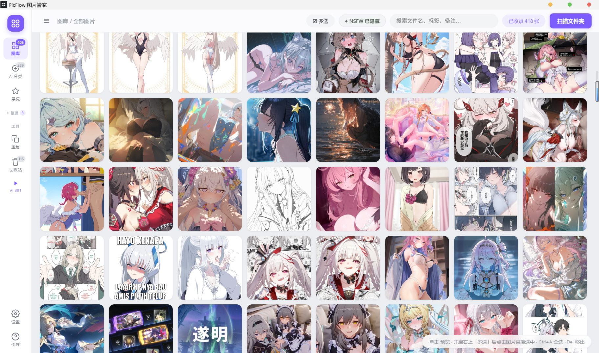
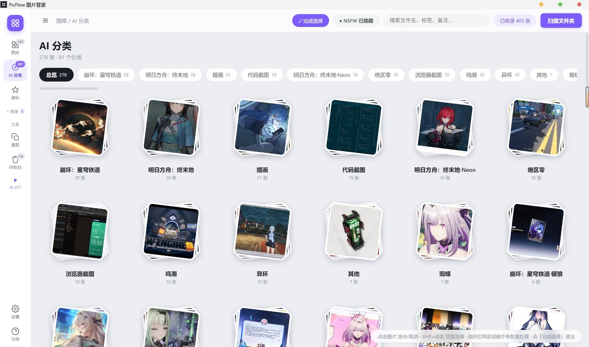

<p align="center">
  
</p>

<h1 align="center">PicFlow</h1>

<p align="center">Windows / macOS 桌面图片管理工具 · 本地管理 · 云端 AI 识别 · 隐私优先</p>

<p align="center">
  <a href="https://github.com/Slimeissoft/PicFlow/releases/latest"></a>
  
  
  
  <br>
  
  
  
</p>

<p align="center">
  <b>简体中文</b> · <a href="README.en.md">English</a> · <a href="README.zh-TW.md">繁體中文</a> · <a href="README.ja.md">日本語</a>
</p>

<p align="center">
  
</p>
<p align="center"><sub>图库视图：左侧按日期 / AI 分类 / 相册 / 标签浏览，顶部搜索与 NSFW 三态过滤，单击看大图</sub></p>

## 功能

- **图库管理**：扫描文件夹（含子目录）、缩略图网格、按日期/类型/标签筛选、搜索
- **AI 识别分类**：调用你配置的大模型 API，识别游戏名 / 角色名 / 图片类型，
  自动归到「原神·雷电将军」「明日方舟」「代码截图」这样的分类
- **手动标注**：像数据标注一样给图片指定分类——灯箱里点分类胶囊或按 `C` 给单张标注，多选后可批量标注。列表带每类数量、支持搜索，也能当场新建分类；标过的图不会被 AI 覆盖
- **右键菜单**：右键任意图片弹出带缩略图的操作菜单——预览、用默认程序打开、在文件夹中显示、复制图片 / 路径、星标、标记 NSFW、标注分类、加入相册、重命名、移动、移出图库、彻底删除。多选后右键可对整批生效；搜索框等输入框右键则是系统的撤销 / 粘贴菜单
- **隐私**：NSFW 图片先用本地模型（nsfwjs）判定，命中的图片**绝不上传**，只在本地打标记；灯箱里点「标记 NSFW」后按钮变红底白字
- **相册 / 标签 / 星标 / 备注**：一张图只属于一个相册，加入新相册自动从旧相册移出
- **重复 / 相似图片检测**：感知哈希（pHash）查重，一键清理
- **批量操作**：多选、批量标注、批量重命名、移动、移出图库、彻底删除（送系统回收站）
- **看图 / 缩放**：非全屏时滚轮缩放、双击进全屏；全屏下单击图片以点击位置放大看细节（再点还原）、双击退出全屏。放大后可拖动平移，右下角比例牌显示「倍数 · 相对原图像素百分比」，点它或按 `1` 直接跳到原始像素 1:1；灯箱加载的是原文件而非缩略图。`←/→` 切换，`Esc` 先还原缩放再退出
- **分类重命名**：AI 分出的分类可改名或合并到已有分类，整组图片一起更新，重新识别不会覆盖
- **相册收纳**：侧栏「整理」一键折叠/展开相册列表，相册多也不占地方
- **多语言**：简体中文 / 繁體中文 / English / 日本語，设置里即时切换
- **文件夹自动同步**：启动后与每 5 分钟静默重扫，外部新增/删除自动反映
- **自动更新**：新版本发布到 GitHub Release 后，旧版本自动收到更新提示并一键下载安装

## AI 分类

<p align="center">
  
</p>
<p align="center"><sub>AI 分类总览：每个分类自动配一张封面，卡片下方是分类名与数量，单击进入该分组</sub></p>

识别结果不是一个笼统的「动漫」标签，而是具体到你认得出的条目——「崩坏：星穹铁道」「明日方舟：终末地」「代码截图」「浏览器截图」「绝区零」。
总览页按图片数量排序，分类可以重命名、合并到已有分类，手动标注过的图片不会被 AI 覆盖。

## 安装

当前最新版 **1.6.3**。Windows 与 macOS 都从 [Releases](https://github.com/Slimeissoft/PicFlow/releases/latest) 下载。

**Windows（10 / 11 x64）**

1. 下载 `PicFlow-Setup-1.6.3.exe`
2. 双击安装（可自选安装目录）
3. 首次启动点「扫描文件夹」导入图片

**macOS（11 Big Sur 及以上，Apple Silicon / Intel）**

1. 下载 `PicFlow-1.6.3-arm64.dmg`（M 系列芯片）或 `PicFlow-1.6.3-x64.dmg`（Intel）
2. 打开 dmg，把「PicFlow」拖进「应用程序」
3. **首次打开请右键 App →「打开」**：这个版本没有 Apple 开发者证书，只做了 ad-hoc 签名，系统会拦一次
4. 若提示「已损坏，无法打开」，在终端执行：

   ```bash
   xattr -cr "/Applications/PicFlow.app"
   ```

macOS 版暂不支持应用内自动更新，新版本请回到 Releases 下载。

## 配置 AI 识别（必做）

AI 识别需要你自己的大模型 API（图片识别会产生少量费用，由你的账号承担）。

1. 点左侧栏底部的 **设置**（齿轮图标）→ **AI 识别** 分区
2. 选择服务商，会**自动填好 API 地址和推荐模型**：

   | 服务商 | 推荐模型 | 说明 |
   |---|---|---|
   | OpenAI | `gpt-4o-mini` / `gpt-4o` | 需支持图片的多模态模型 |
   | Anthropic Claude | `claude-sonnet-4-5` | Claude 全系列支持图片 |
   | 通义千问（阿里云） | `qwen-vl-max` | DashScope 兼容模式 |
   | Kimi（月之暗面） | `moonshot-v1-8k-vision-preview` | 需 vision 模型 |
   | 豆包（火山方舟） | 方舟推理接入点 ID | 按控制台填 |
   | 硅基流动 | `Qwen/Qwen2.5-VL-72B-Instruct` | 聚合平台，可选多模型 |
   | DeepSeek | `deepseek-chat` | 需使用支持视觉的模型 |
   | 自定义 | 任意 | 任何 OpenAI 兼容接口 |

3. 填入 **API Key**（用系统凭据加密后只存在本机，不上传任何服务器）
4. 点「测试连接」确认可用 → 保存
5. 回到图库点顶部 **⚡ AI 识别**

**并发数**：默认 3（同时识别 3 张）。遇到 API 限流（429）就调低；额度充足可调到 4-5 加速。

**费用参考**：识别一张图约消耗 1 次图片输入（缩到 1024px 的 JPEG），
按各家视觉模型的价格计费，通常每张几分钱到几毛钱。

## 使用说明

macOS 上把下表的 `Ctrl` 读作 `⌘`、`Del` 读作 `⌫`（界面里也会自动显示成 ⌘）。

| 操作 | 方式 |
|---|---|
| 预览大图 | 单击图片 |
| 缩放 | 非全屏：滚轮缩放（1:1 可点右下角比例牌或按 `1`） |
| 放大看细节 | 全屏：**单击图片**以点击位置放大 2.6×，再点还原，按住拖动平移 |
| 全屏 / 退出全屏 | 双击图片；或按 `F` / 点右上全屏按钮；`Esc` 先还原缩放，再按一次退出 |
| 切换上一张/下一张 | `←` / `→` 或左右箭头 |
| 选中多张 | 右上「☑ 多选」开启后点图；`Ctrl+A` 全选 |
| 右键菜单 | 右键图片：预览 / 复制图片 / 复制路径 / 星标 / 标记 NSFW / 标注分类 / 加入相册 / 重命名 / 移动 / 移出 / 彻底删除；多选后右键对整批生效 |
| 复制图片 / 路径 | 右键菜单；或 `Ctrl+C` 复制图片、`Ctrl+Shift+C` 复制路径（灯箱里同样可用） |
| 快速重命名 | 选中图片按 `F2` |
| 批量标注分类 | 选中多张 → 底部「标注分类…」→ 选已有分类或输入新分类 |
| 单张标注分类 | 灯箱右侧点分类胶囊或「✎ 标注」，也可按 `C`；列表可搜索、可新建 |
| 重命名 AI 分类 | AI 分类总览卡片右上角 ✎，或分类内右上「重命名分类」；也可合并到已有分类 |
| 折叠相册 | 点侧栏「整理」标题（箭头收起 / 展开，展开状态会被记住） |
| 切换语言 | 设置 → 常规 → 界面语言（简中 / 繁中 / English / 日本語） |
| 移出图库（保留文件） | 选中 → 「移出」；可在左侧「回收站」恢复 |
| 彻底删除（进系统回收站） | 选中 → 「彻底删除」 |
| 重复图片 | 左侧「重复」视图 |
| NSFW 显示 | 顶部 NSFW 按钮循环：隐藏 → 显示全部 → 仅看 NSFW |

## 隐私说明

- 图片文件始终在你本机，PicFlow 不上传图片到自己的服务器
- AI 识别时，图片会发送到**你自己配置的 API**（这是识别的必要步骤）
- **NSFW 图片绝不上传**：每张图先在本地用 nsfwjs 判定，命中 NSFW 的直接跳过
- API Key 用系统凭据（Windows DPAPI / Electron `safeStorage`）加密后保存在本机 `library.json`，
  渲染层只能拿到「是否已配置」与掩码，仍建议不要分享该文件
- 发现安全问题请按 [SECURITY.md](SECURITY.md) 私下报告，不要开公开 issue

## 自动更新（仅 Windows）

软件启动后会自动检查 GitHub Releases（8 秒后静默检查一次）。
发现新版本时，底部会弹出提示条：

- 点「下载更新」→ 显示下载进度 → 完成后点「重启安装」
- 更新只下载变更部分（electron-updater 差量更新），比重新下载安装包快

> 注意：v1.4.0 之前的版本没有自动更新功能，需要手动安装一次 v1.4.0，之后即可自动升级。
>
> macOS 版是 ad-hoc 签名（无开发者证书），Squirrel.Mac 无法校验更新包，因此不启用应用内更新。

## 数据位置

| 内容 | 位置 |
|---|---|
| 图库数据（分类/相册/标签/备注） | `%APPDATA%\PicFlow\library.json` |
| 缩略图缓存 | `%APPDATA%\PicFlow\thumbs\` |
| AI 配置（API Key 加密保存） | 同上 `library.json` 的 `flags.cloudAI` |
| 你的图片 | 原位置不动，PicFlow 不移动/不改名 |

macOS 上对应 `~/Library/Application Support/PicFlow/`。

备份只需复制 `library.json`（缩略图可重新生成）。从 1.6.3 及更早版本升级时，旧目录 `PicFlow 图片管家` 里的图库与缩略图会自动导入，之后旧目录可以手动删掉。

## 开发

```bash
npm install
npm start      # 开发运行
npm run dist   # 打包 Windows 安装版（输出到 release/）
```

技术栈：Electron 33 + 原生 JS（无前端框架）+ nsfwjs（本地 NSFW）+ electron-updater（自动更新）。

主要文件：

| 文件 | 职责 |
|---|---|
| `main.js` | 主进程：扫描、缩略图、文件操作、AI 调度、自动更新 |
| `cloudai.js` | 云端大模型调用（OpenAI 兼容 + Anthropic 两种协议、服务商预设） |
| `ai.js` | 本地 NSFW 检测（nsfwjs） |
| `db.js` | JSON 数据库（library.json 读写、软删除、忽略列表） |
| `scanner.js` | 目录遍历、EXIF 日期、感知哈希（pHash） |
| `renderer/` | 界面（index.html / app.js / style.css / i18n.js 多语言词表） |

## 已知限制

- Windows 用 NSIS 安装包，macOS 用 dmg / zip
- macOS 版未签名、未公证（ad-hoc 签名），首次打开需右键 →「打开」；也没有应用内自动更新
- AI 识别速度取决于你所选模型服务商（通常每张 1-5 秒）
- 本地离线识别已移除；无网络时 AI 分类不可用（图库管理功能不受影响）

## 更新记录

**v1.6.3**（2026-11-06）

- 新增 **macOS 版**：Apple Silicon（`arm64`）与 Intel（`x64`）各提供 dmg 与 zip
- macOS 适配：`⌘` 快捷键提示、`⌫` 删除、系统应用菜单（`⌘Q` / `⌘W`）、关窗不退出进程、删除走废纸篓
- macOS 版为 ad-hoc 签名（无 Apple 开发者证书），首次打开需右键 →「打开」；暂不支持应用内自动更新
- 文档：重写 [SECURITY.md](SECURITY.md)；README 增加 English / 繁體中文 / 日本語 三个版本
- Windows 行为无变化，仅同步版本号

**v1.6.2**（2026-11-06）· 建议所有用户升级

安全加固版本，功能无变化：

- **禁止导航到外部页面**：`will-navigate` 只放行 `file://`，`window.open` 一律拒绝。此前窗口一旦被导航到远程页面，preload 会重新注入，那个页面就能拿到完整的 `window.api`
- **IPC 全面收紧**：40+ 个处理器统一校验发送方必须是本地页面；`read-image` / `copy-image` / `open-path` / `rename` / `move` / `purge` / `revive` / `open-in-folder` 增加图库路径白名单，只接受数据库内记录或已扫描目录下的文件
- **修复目录穿越**：重命名时清洗 `\ / : * ? " < > |` 与控制字符，并强制目标与原文件同目录
- **API Key 加密存储**：改用系统凭据（`safeStorage`）加密后写入 `library.json`；渲染层只能拿到「是否已配置」和掩码（`sk-…9999`），明文不再下发；设置里留空即保持原 Key
- **渲染进程开启沙箱**（`sandbox: true`），preload 仍正常工作
- **CSP 收紧**：`img-src` 显式允许 `picflow-thumb:`，补 `object-src` / `base-uri` / `form-action` / `frame-src`；自定义协议去掉 `bypassCSP`、加上 `corsEnabled`

**v1.6.1**（2026-11-06）

- 新增**图片右键菜单**：缩略图与灯箱里都能右键，菜单头带缩略图与文件信息
  - 打开预览 / 用默认程序打开 / 在文件夹中显示
  - 复制图片到剪贴板、复制文件路径（`Ctrl+C` / `Ctrl+Shift+C`）
  - 星标、标记 NSFW（按当前状态自动切换为「取消」）
  - 标注分类、加入相册（二级菜单直接选相册，带当前归属 ✓，可当场新建）、从当前相册移出
  - 重命名（`F2`）、移动到文件夹、移入软件回收站、彻底删除
- 多选后右键可对整批图片执行上述操作，菜单头显示「已选 N 张」与合计大小
- 菜单跟随主题与语言（简 / 繁 / 英 / 日），靠近屏幕边缘自动翻转，支持 `↑↓` / `Enter` / `Esc`
- 回收站与 AI 分类总览卡片也有对应右键菜单
- 修复「标记 NSFW 后按钮偶尔不变红」：后台自动同步会整批替换图片对象，灯箱面板拿到旧引用导致界面不刷新；改为按路径回查最新对象并乐观更新，写盘失败自动回滚
- 修复搜索框等输入框无法右键粘贴：补上系统原生编辑菜单
- README 增加主界面截图

**v1.6.0**（2026-11-02）

- 新增**手动标注**：灯箱右侧点分类胶囊、点「✎ 标注」或按 `C`，把这张图直接归到正确分类；多选后底部「标注分类…」可批量标注
- 标注弹窗：每类显示真实数量、支持搜索过滤、可直接输入新名字新建分类；写入后标记为手动，重新跑 AI 识别不会覆盖
- 灯箱「标记 NSFW」后按钮变**红底白字**（星标同理变黄底）
- 修复星标 / NSFW 按钮状态样式从未生效（模板少写了 `class=`，`on` 被当成 HTML 属性）
- 修复标记后当前图片错位：灯箱改为按路径跟踪，标记完再按 `N` 不会改到别的图
- 修复侧栏「设置 / 引导」两颗按钮露出 Windows 原生按钮灰底与黑色 3D 边框
- 更新使用引导：换成云端 API 流程，补充分类重命名、手动标注、灯箱手势说明

**v1.5.0**（2026-10-25）

- 灯箱缩放：非全屏滚轮缩放、双击进全屏；全屏单击放大 2.6 倍（再点还原）、双击退出全屏；放大后可拖动平移；右下角比例牌显示「倍数 · 相对原图百分比」，点一下或按 `1` 跳到原始像素 1:1；灯箱读的是原文件全分辨率，不是缩略图
- 修复全屏模式下左右切换箭头位置错位（信息面板收起后箭头没归位）
- 修复点开 AI 分类分组后仍停留在总览卡片墙的问题
- AI 分类支持重命名（也可合并到已有分类），整组图片一起更新，重新识别不会覆盖
- 侧栏「整理」相册区可一键折叠/展开，折叠时显示相册数量
- 去掉 AI 分类总览卡片悬停时的半透明方框
- 「AI 设置」改为「设置」，分常规 / AI 识别 / 外观 / 数据 / 关于五区
- 新增多语言：简体中文 / 繁體中文 / English / 日本語
- 分类很多时分类条改为单行横向滚动，不再挤压图片区

**v1.4.0**（2026-10-21）· 重大变化

- 移除本地 AI 识别模型（WD14 / MobileNetV2），改为用户自有 API 的云端多模态识别——识别质量更高、安装包更小，本地只保留 NSFW 检测，确保敏感图片绝不上传
- 新增批量标注分类、灯箱全屏查看、electron-updater 自动更新

## License

本项目使用 MIT License，请勿将本软件用于非法用途。

Feel free to enjoy open-source!

Copyright (c) 2026 Slimeissoft

## Contact with Me

- **Email**：[lalouuie@gmail.com](mailto:lalouuie@gmail.com)
- **GitHub**：[@Slimeissoft](https://github.com/Slimeissoft)
