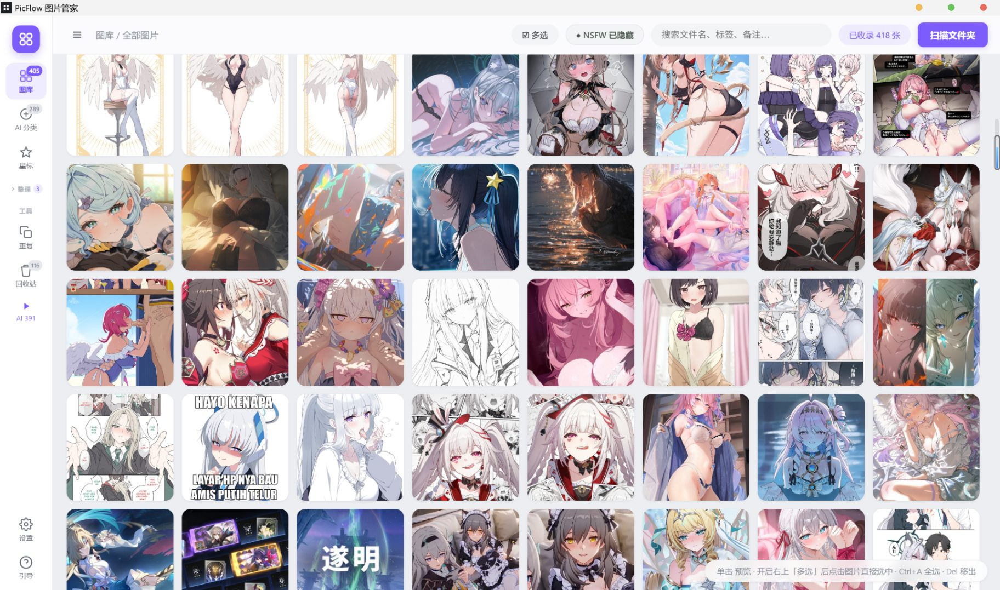
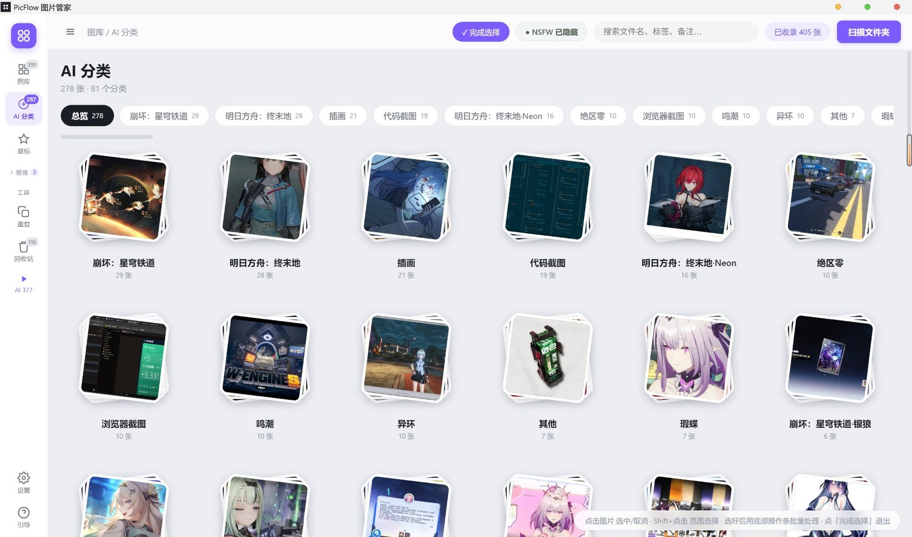

<p align="center">
  
</p>

<h1 align="center">PicFlow 圖片管家</h1>

<p align="center">一款 Windows 桌面圖片管理工具 · 本機管理 · 雲端 AI 辨識 · 隱私優先</p>

<p align="center">
  <a href="https://github.com/Slimeissoft/PicFlow/releases/latest"></a>
  
  
  
  <br>
  
  
  
</p>

<p align="center">
  <a href="README.md">简体中文</a> · <a href="README.en.md">English</a> · <b>繁體中文</b> · <a href="README.ja.md">日本語</a>
</p>

<p align="center">
  
</p>
<p align="center"><sub>圖庫檢視：左側依日期 / AI 分類 / 相簿 / 標籤瀏覽，頂部搜尋與 NSFW 三態過濾，單擊看大圖</sub></p>

## 功能

- **圖庫管理**：掃描資料夾（含子資料夾）、縮圖格狀檢視、依日期 / 類型 / 標籤篩選、搜尋
- **AI 辨識分類**：呼叫你設定的多模態 API，辨識遊戲名 / 角色名 / 圖片類型，
  自動歸到「崩壞：星穹鐵道」「明日方舟」「程式碼截圖」這樣的分類
- **手動標註**：像資料標註一樣指定分類——燈箱裡點分類膠囊或按 `C` 標註單張，多選後可批次標註。清單帶每類數量、支援搜尋，也能當場新增分類；標註過的圖片不會被 AI 覆蓋
- **右鍵選單**：在任意圖片上按右鍵，彈出帶縮圖的操作選單——預覽、以預設程式開啟、在資料夾中顯示、複製圖片 / 路徑、加星號、標記 NSFW、標註分類、加入相簿、重新命名、移動、移出圖庫、永久刪除。多選後右鍵可整批套用；搜尋框等輸入框按右鍵則是系統的復原 / 貼上選單
- **隱私**：NSFW 圖片先用本機模型（nsfwjs）判定，命中的圖片**絕不上傳**，只在本機打標記；燈箱裡點「標記 NSFW」後按鈕變紅底白字
- **相簿 / 標籤 / 星號 / 備註**：一張圖只屬於一個相簿，加入新相簿會自動從舊相簿移出
- **重複 / 相似圖片偵測**：感知雜湊（pHash）查重，一鍵清理
- **批次操作**：多選、批次標註、批次重新命名、移動、移出圖庫、永久刪除（送系統資源回收筒）
- **看圖 / 縮放**：非全螢幕時滾輪縮放、雙擊進全螢幕；全螢幕下單擊圖片以點擊位置放大看細節（再點還原）、雙擊退出全螢幕。放大後可拖曳平移，右下角比例牌顯示「倍數 · 相對原圖像素百分比」，點它或按 `1` 直接跳到原始像素 1:1；燈箱載入的是原始檔案而非縮圖。`←/→` 切換，`Esc` 先還原縮放再退出
- **分類重新命名**：AI 分出的分類可改名或合併到既有分類，整組圖片一起更新，重新辨識不會覆蓋
- **相簿收納**：側欄「整理」一鍵折疊 / 展開相簿清單，相簿再多也不佔空間
- **多語言**：简体中文 / 繁體中文 / English / 日本語，設定裡即時切換
- **資料夾自動同步**：啟動後與每 5 分鐘靜默重新掃描，外部新增 / 刪除自動反映
- **自動更新**：新版本發佈到 GitHub Release 後，舊版本自動收到更新提示並一鍵下載安裝

## AI 分類

<p align="center">
  
</p>
<p align="center"><sub>AI 分類總覽：每個分類自動配一張封面，卡片下方是分類名與數量，單擊進入該分組</sub></p>

辨識結果不是一個籠統的「動漫」標籤，而是具體到你認得出的項目——「崩壞：星穹鐵道」「明日方舟：終末地」「程式碼截圖」「瀏覽器截圖」「絕區零」。
總覽頁依圖片數量排序，分類可以重新命名、合併到既有分類，手動標註過的圖片不會被 AI 覆蓋。

## 安裝

1. 從 [Releases](https://github.com/Slimeissoft/PicFlow/releases/latest) 下載 `PicFlow-Setup-*.exe`
2. 雙擊安裝（可自選安裝目錄）
3. 首次啟動點「掃描資料夾」匯入圖片

系統需求：Windows 10/11 x64。目前最新版 **1.6.2**（安全加固，建議所有使用者升級）。

## 設定 AI 辨識（必做）

AI 辨識需要你自己的大模型 API（圖片辨識會產生少量費用，由你的帳號負擔）。

1. 點左側欄底部的 **設定**（齒輪圖示）→ **AI 辨識** 分區
2. 選擇服務商，會**自動填好 API 位址與推薦模型**：

   | 服務商 | 推薦模型 | 說明 |
   |---|---|---|
   | OpenAI | `gpt-4o-mini` / `gpt-4o` | 需支援圖片的視覺模型 |
   | Anthropic Claude | `claude-sonnet-4-5` | Claude 全系列支援圖片 |
   | 通義千問（阿里雲） | `qwen-vl-max` | DashScope 相容模式 |
   | Kimi（月之暗面） | `moonshot-v1-8k-vision-preview` | 需 vision 模型 |
   | 豆包（火山方舟） | 方舟推理接入點 ID | 依控制台填寫 |
   | 矽基流動 | `Qwen/Qwen2.5-VL-72B-Instruct` | 聚合平台，可選多模型 |
   | DeepSeek | `deepseek-chat` | 需使用支援視覺的模型 |
   | 自訂 | 任意 | 任何 OpenAI 相容介面 |

3. 填入 **API Key**（以系統憑證加密後只存在本機，不上傳任何伺服器）
4. 點「測試連線」確認可用 → 儲存
5. 回到圖庫點頂部 **⚡ AI 辨識**

**並行數**：預設 3（同時辨識 3 張）。遇到 API 限流（429）就調低；額度充足可調到 4-5 加速。

**費用參考**：辨識一張圖約消耗 1 次圖片輸入（縮到 1024px 的 JPEG），
依各家視覺模型價格計費，通常每張幾分錢到幾毛錢。

## 使用說明

| 操作 | 方式 |
|---|---|
| 預覽大圖 | 單擊圖片 |
| 縮放 | 非全螢幕：滾輪縮放（1:1 可點右下角比例牌或按 `1`） |
| 放大看細節 | 全螢幕：**單擊圖片**以點擊位置放大 2.6×，再點還原，按住拖曳平移 |
| 全螢幕 / 退出全螢幕 | 雙擊圖片；或按 `F` / 點右上全螢幕按鈕；`Esc` 先還原縮放，再按一次退出 |
| 切換上一張 / 下一張 | `←` / `→` 或左右箭頭 |
| 選取多張 | 右上「☑ 多選」開啟後點圖；`Ctrl+A` 全選 |
| 右鍵選單 | 右鍵圖片：預覽 / 複製圖片 / 複製路徑 / 加星號 / 標記 NSFW / 標註分類 / 加入相簿 / 重新命名 / 移動 / 移出 / 永久刪除；多選後右鍵對整批套用 |
| 複製圖片 / 路徑 | 右鍵選單；或 `Ctrl+C` 複製圖片、`Ctrl+Shift+C` 複製路徑（燈箱裡同樣可用） |
| 快速重新命名 | 選取圖片按 `F2` |
| 批次標註分類 | 選取多張 → 底部「標註分類…」→ 選既有分類或輸入新分類 |
| 單張標註分類 | 燈箱右側點分類膠囊或「✎ 標註」，也可按 `C`；清單可搜尋、可新增 |
| 重新命名 AI 分類 | AI 分類總覽卡片右上角 ✎，或分類內右上「重新命名分類」；也可合併到既有分類 |
| 折疊相簿 | 點側欄「整理」標題（箭頭收起 / 展開，展開狀態會被記住） |
| 切換語言 | 設定 → 一般 → 介面語言（简中 / 繁中 / English / 日本語） |
| 移出圖庫（保留檔案） | 選取 → 「移出」；可在左側「資源回收筒」還原 |
| 永久刪除（進系統資源回收筒） | 選取 → 「永久刪除」 |
| 重複圖片 | 左側「重複」檢視 |
| NSFW 顯示 | 頂部 NSFW 按鈕循環：隱藏 → 顯示全部 → 僅看 NSFW |

## 隱私說明

- 圖片檔案始終在你本機，PicFlow 不上傳圖片到自己的伺服器
- AI 辨識時，圖片會傳送到**你自己設定的 API**（這是辨識的必要步驟）
- **NSFW 圖片絕不上傳**：每張圖先在本機用 nsfwjs 判定，命中 NSFW 的直接跳過
- API Key 以系統憑證（Windows DPAPI / Electron `safeStorage`）加密後保存在本機 `library.json`，
  渲染層只能拿到「是否已設定」與遮罩，仍建議不要分享該檔案
- 發現安全性問題請依 [SECURITY.md](SECURITY.md) 私下回報，不要開公開 issue

## 自動更新

軟體啟動後會自動檢查 GitHub Releases（8 秒後靜默檢查一次）。
發現新版本時，底部會跳出提示列：

- 點「下載更新」→ 顯示下載進度 → 完成後點「重新啟動安裝」
- 更新只下載變更部分（electron-updater 差異更新），比重新下載安裝包快

> 注意：v1.4.0 之前的版本沒有自動更新功能，需要手動安裝一次 v1.4.0，之後即可自動升級。

## 資料位置

| 內容 | 位置 |
|---|---|
| 圖庫資料（分類 / 相簿 / 標籤 / 備註） | `%APPDATA%\PicFlow 图片管家\library.json` |
| 縮圖快取 | `%APPDATA%\PicFlow 图片管家\thumbs\` |
| AI 設定（API Key 加密保存） | 同上 `library.json` 的 `flags.cloudAI` |
| 你的圖片 | 原位不動，PicFlow 不移動 / 不改名 |

備份只需複製 `library.json`（縮圖可重新產生）。

## 開發

```bash
npm install
npm start      # 開發執行
npm run dist   # 打包 Windows 安裝版（輸出到 release/）
```

技術堆疊：Electron 33 + 原生 JS（無前端框架）+ nsfwjs（本機 NSFW）+ electron-updater（自動更新）。

主要檔案：

| 檔案 | 職責 |
|---|---|
| `main.js` | 主程序：掃描、縮圖、檔案操作、AI 排程、自動更新 |
| `cloudai.js` | 雲端大模型呼叫（OpenAI 相容 + Anthropic 兩種協定、服務商預設） |
| `ai.js` | 本機 NSFW 偵測（nsfwjs） |
| `db.js` | JSON 資料庫（library.json 讀寫、軟刪除、忽略清單） |
| `scanner.js` | 目錄走訪、EXIF 日期、感知雜湊（pHash） |
| `renderer/` | 介面（index.html / app.js / style.css / i18n.js 多語言詞表） |

## 已知限制

- 僅支援 Windows（NSIS 安裝包）
- AI 辨識速度取決於你選的模型服務商（通常每張 1-5 秒）
- 本機離線辨識已移除；無網路時 AI 分類不可用（圖庫管理功能不受影響）

## 更新記錄

**v1.6.2**（2026-11-06）· 建議所有使用者升級

安全加固版本，功能無變化：

- **禁止導覽到外部頁面**：`will-navigate` 只放行 `file://`，`window.open` 一律拒絕。此前視窗一旦被導覽到遠端頁面，preload 會重新注入，那個頁面就能拿到完整的 `window.api`
- **IPC 全面收緊**：40+ 個處理器統一校驗傳送方必須是本機頁面；`read-image` / `copy-image` / `open-path` / `rename` / `move` / `purge` / `revive` / `open-in-folder` 增加圖庫路徑白名單，只接受資料庫內記錄或已掃描目錄下的檔案
- **修正路徑穿越**：重新命名時清洗 `\ / : * ? " < > |` 與控制字元，並強制目標與原始檔案同目錄
- **API Key 加密儲存**：改用系統憑證（`safeStorage`）加密後寫入 `library.json`；渲染層只能拿到「是否已設定」與遮罩（`sk-…9999`），明文不再下發；設定裡留空即保持原 Key
- **渲染程序開啟沙箱**（`sandbox: true`），preload 仍正常運作
- **CSP 收緊**：`img-src` 明確允許 `picflow-thumb:`，補上 `object-src` / `base-uri` / `form-action` / `frame-src`；自訂協定移除 `bypassCSP`、加上 `corsEnabled`

**v1.6.1**（2026-11-06）

- 新增**圖片右鍵選單**：縮圖與燈箱裡都能按右鍵，選單標頭帶縮圖與檔案資訊
  - 開啟預覽 / 以預設程式開啟 / 在資料夾中顯示
  - 複製圖片到剪貼簿、複製檔案路徑（`Ctrl+C` / `Ctrl+Shift+C`）
  - 加星號、標記 NSFW（依目前狀態自動切換為「取消」）
  - 標註分類、加入相簿（子選單直接選相簿，帶目前歸屬 ✓，可當場新增）、從目前相簿移出
  - 重新命名（`F2`）、移動到資料夾、移入軟體資源回收筒、永久刪除
- 多選後右鍵可對整批圖片執行上述操作，選單標頭顯示「已選 N 張」與合計大小
- 選單跟隨主題與語言（简 / 繁 / 英 / 日），靠近螢幕邊緣自動翻轉，支援 `↑↓` / `Enter` / `Esc`
- 資源回收筒與 AI 分類總覽卡片也有對應右鍵選單
- 修正「標記 NSFW 後按鈕偶爾不變紅」：背景自動同步會整批替換圖片物件，燈箱面板拿到舊參照導致介面不重新整理；改為依路徑回查最新物件並樂觀更新，寫入失敗自動復原
- 修正搜尋框等輸入框無法右鍵貼上：補上系統原生編輯選單
- README 增加主介面截圖

**v1.6.0**（2026-11-02）

- 新增**手動標註**：燈箱右側點分類膠囊、點「✎ 標註」或按 `C`，把這張圖直接歸到正確分類；多選後底部「標註分類…」可批次標註
- 標註視窗：每類顯示真實數量、支援搜尋過濾、可直接輸入新名稱新增分類；寫入後標記為手動，重新跑 AI 辨識不會覆蓋
- 燈箱「標記 NSFW」後按鈕變**紅底白字**（星號同理變黃底）
- 修正星號 / NSFW 按鈕狀態樣式從未生效（範本少寫了 `class=`，`on` 被當成 HTML 屬性）
- 修正標記後目前圖片錯位：燈箱改為依路徑追蹤，標記完再按 `N` 不會改到別的圖
- 修正側欄「設定 / 引導」兩顆按鈕露出 Windows 原生按鈕灰底與黑色 3D 邊框
- 更新使用引導：換成雲端 API 流程，補充分類重新命名、手動標註、燈箱手勢說明

**v1.5.0**（2026-10-25）

- 燈箱縮放：非全螢幕滾輪縮放、雙擊進全螢幕；全螢幕單擊放大 2.6 倍（再點還原）、雙擊退出全螢幕；放大後可拖曳平移；右下角比例牌顯示「倍數 · 相對原圖百分比」，點一下或按 `1` 跳到原始像素 1:1；燈箱讀的是原始檔案全解析度，不是縮圖
- 修正全螢幕模式下左右切換箭頭位置錯位（資訊面板收起後箭頭沒歸位）
- 修正點開 AI 分類分組後仍停留在總覽卡片牆的問題
- AI 分類支援重新命名（也可合併到既有分類），整組圖片一起更新，重新辨識不會覆蓋
- 側欄「整理」相簿區可一鍵折疊 / 展開，折疊時顯示相簿數量
- 移除 AI 分類總覽卡片懸停時的半透明方框
- 「AI 設定」改為「設定」，分一般 / AI 辨識 / 外觀 / 資料 / 關於五區
- 新增多語言：简体中文 / 繁體中文 / English / 日本語
- 分類很多時分類條改為單行橫向捲動，不再擠壓圖片區

**v1.4.0**（2026-10-21）· 重大變化

- 移除本機 AI 辨識模型（WD14 / MobileNetV2），改為使用者自有 API 的雲端多模態辨識——辨識品質更高、安裝包更小，本機只保留 NSFW 偵測，確保敏感圖片絕不上傳
- 新增批次標註分類、燈箱全螢幕檢視、electron-updater 自動更新

## License

本專案使用 MIT License，請勿將本軟體用於非法用途。

Feel free to enjoy open-source!

Copyright (c) 2026 Slimeissoft

## Contact with Me

- **Email**：[lalouuie@gmail.com](mailto:lalouuie@gmail.com)
- **GitHub**：[@Slimeissoft](https://github.com/Slimeissoft)
